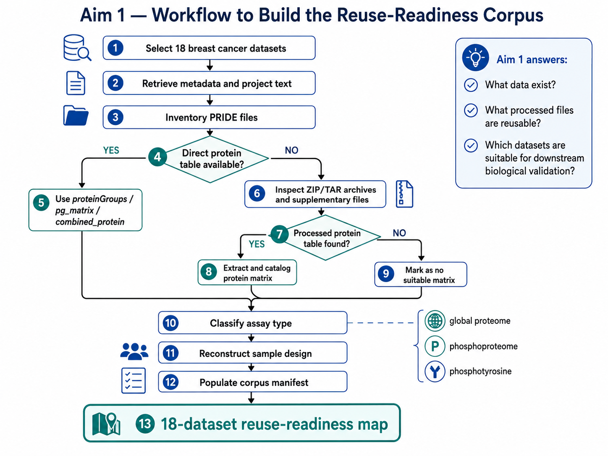
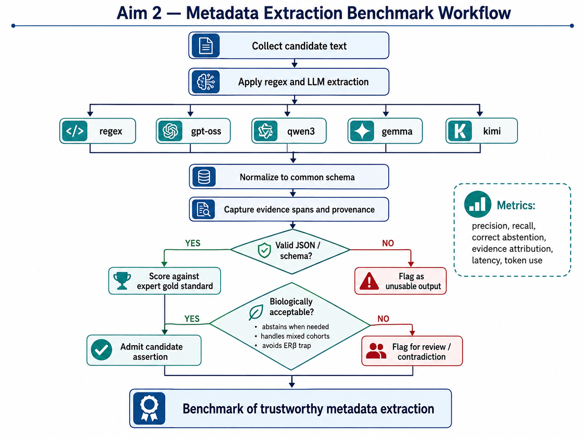
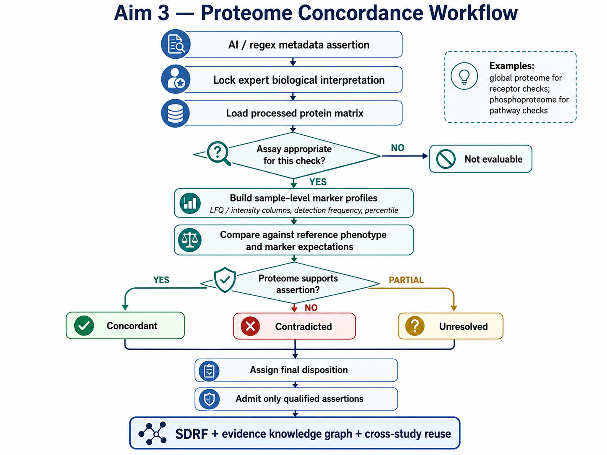
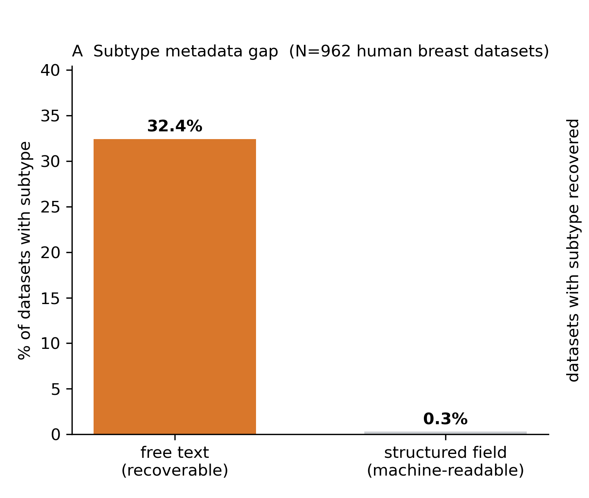
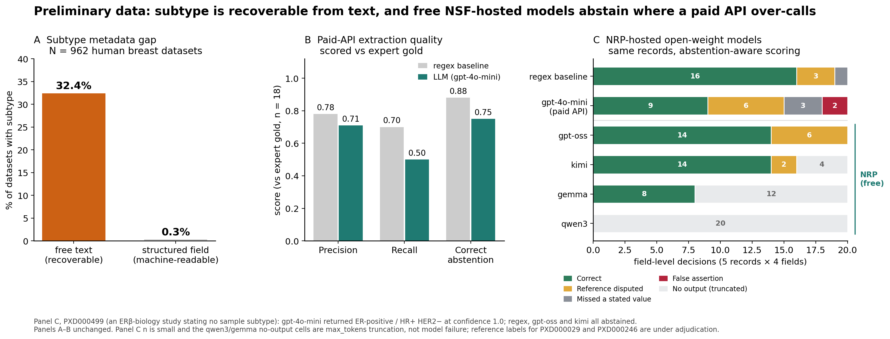
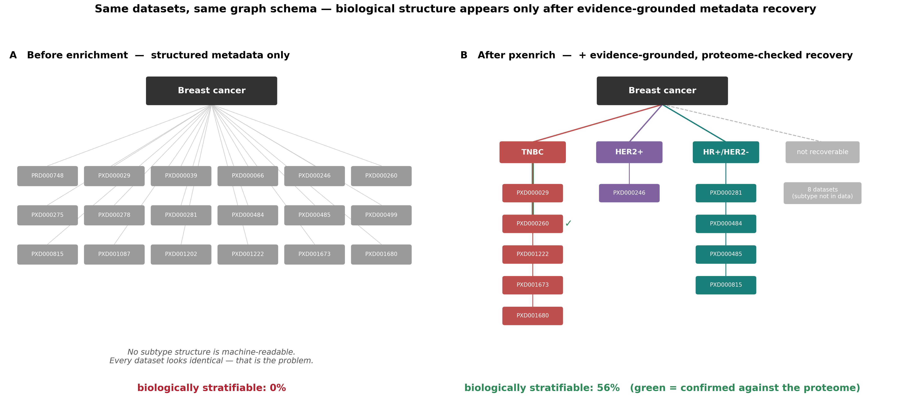

# pxEnrich

**Evidence-grounded enrichment and validation of biological metadata for public proteomics**

pxEnrich addresses a major barrier to the reuse of public proteomics data: biologically important metadata frequently exists, but is fragmented across ProteomeXchange repository records, publications, supplementary files, filenames, and processed datasets.

The project develops methods to recover, normalize, trace, and validate this information while explicitly representing evidence, uncertainty, and unsupported inference.

> **For reviewers:** This repository provides the Specific Aims workflows and selected preliminary results supporting the pxEnrich research strategy. Development code and internal research materials are maintained separately.

---

## Overall Strategy

ProteomeXchange has made large-scale public proteomics data sharing possible. However, public availability does not necessarily make a dataset biologically reusable. pxEnrich focuses on the gap between **data deposition** and **reliable biological interpretation**, particularly for retrospective reuse of existing datasets.

---

## Specific Aim 1

We will build an independently dual-curated gold standard for human breast cancer datasets in PRIDE and benchmark a panel of extraction methods against it   a transparent regex baseline plus open-weight and commercial language models using abstention-aware metrics that separate three failure modes: silence, error, and over-call. The deliverable is a quantitative account of where automated recovery is reliable and where it is not.

---

## Specific Aim 2

For each dataset with a recovered subtype claim, we will measure the abundance of the canonical receptor markers (ESR1, PGR, ERBB2) in the deposited quantitative matrices and classify each claim as corroborated, contradicted, or evidentially insufficient. We will explicitly distinguish technical evaluability   whether a marker could have been observed given the experimental design and depth   from biological absence, and will characterize the underlying distributions before proposing any decision threshold

##

---

## Specific Aim 3

Validated annotations will be emitted as HUPO-PSI SDRF-Proteomics files with ontology-grounded terms, verified with the official community validator, and released with the full provenance chain   source text span, method, evidence class   under a persistent DOI, together with the pipeline required to regenerate them.

##

---

## Preliminary Results

### Public proteomics metadata gap

A preliminary survey of 962 human breast-cancer datasets in PRIDE found a large metadata gap: molecular subtype was recoverable from free text in 32.4% of datasets, but appeared in structured machine-readable fields in only 0.3%. In other words, biologically important information often exists, but not in a form that is easy to search, compare, or reuse computationally.

### Metadata reconstruction benchmark

We created an expert-curated proof-of-concept set of 18 breast-cancer proteomics datasets and compared a deterministic regex baseline with an off-the-shelf LLM extraction run using gpt-4o-mini. The benchmark measures agreement with expert annotations for subtype-related fields and includes correct abstention as a first-class outcome.

### Knowledge representation / evidence integration

**Evidence-grounded metadata recovery reveals biological structure hidden in public proteomics datasets.**
 Before enrichment, 18 breast-cancer ProteomeXchange datasets could not be stratified by molecular subtype using structured repository metadata alone (A). Following pxEnrich evidence recovery, 10 of 18 datasets (56%) could be assigned to TNBC, HER2-positive, or HR-positive/HER2-negative groups, while eight remained unclassified because subtype information was not sufficiently supported (B). pxEnrich therefore increases biological interpretability while retaining an explicit “not recoverable” state rather than inferring unsupported labels. Proteomic consistency checks provide an additional validation layer for recovered annotations where applicable.

---

## Why pxEnrich?

Current public proteomics infrastructure has made data deposition increasingly standardized, but retrospective biological reuse remains difficult when phenotype and experimental context are incomplete, inconsistently represented, or buried in unstructured sources.

pxEnrich is being developed to address this gap through:

- evidence-grounded metadata reconstruction;
- provenance tracking at the individual assertion level;
- explicit confidence and abstention;
- normalization of heterogeneous biological terminology;
- identification of conflicting or unsupported annotations; and
- biological consistency assessment using the underlying proteomic evidence where appropriate.

---

## Repository Scope

This repository contains public-facing documentation, Specific Aims diagrams, and selected preliminary analyses associated with the pxEnrich project.

The active development repository, source code, internal datasets, and ongoing analyses are maintained separately while the research is under development.

---

## Project Status

pxEnrich is an active research project under development at the Arkansas INBRE Data Science Core, University of Arkansas for Medical Sciences.
